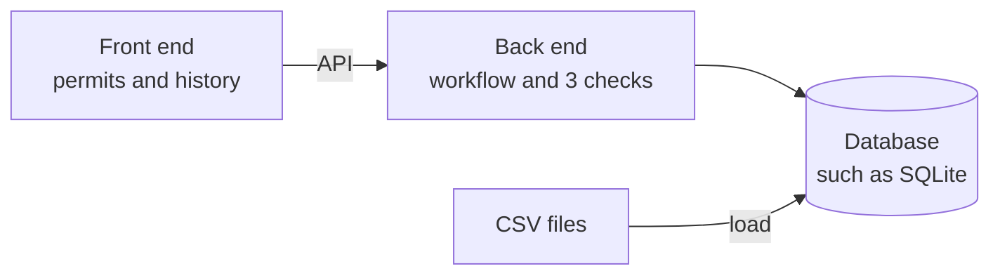

# Kuwait GitHub Copilot Hackathon - Nov 2026

    

🎯 **Your mission:** make sure only the right person can approve hazardous work, and prove it afterwards.

> [!IMPORTANT]
> Sample data only. Never bring real personnel data or credentials into this repo. This is a prototype, not a certified safety system, so never use it to authorize real work.

## 💼 The business problem

**The problem:** permits for hazardous work on an oil and gas site are still on paper, so permits get lost, steps get skipped and nobody can prove who approved what.

**Why it matters:** the wrong person approving hot work, or someone approving their own work, can be fatal. Every approval must come from the right person and be provable later.

## 🧰 What you'll build

You get the site's people, roles, sites and permit types. Your app lets a requester ask for a permit and the site's area authority approve and close it. It refuses any action by the wrong person and keeps a full history for every permit.



Build it in three parts: a database, a back end that runs the workflow and the checks behind an API, and a front end that does everything through that API.

**The data**

| File | Rows | What it represents |
|---|---:|---|
| [`users.csv`](data/users.csv) | 24 | The people who use the app: their roles (`roles`), the sites they're assigned to (`sites`) and whether they're active (`active`) |
| [`roles.csv`](data/roles.csv) | 4 | The roles: requester, area authority, HSE officer and viewer |
| [`sites.csv`](data/sites.csv) | 6 | The sites where the work happens (`site_id`) |
| [`permit_types.csv`](data/permit_types.csv) | 6 | The kinds of hazardous work that need a permit, such as hot work (`permit_type_id`) |
| [`sample_requests.csv`](data/sample_requests.csv) | 20 | Permit requests for one work week (15 to 19 November 2026) to try in your app: who asks (`requested_by`), where (`site_id`), for what (`permit_type_id`) and when (`valid_from`, `valid_to`) |

All data is synthetic. The sites, people and work are fictional. The [data dictionary](data/README.md) explains every column and the data-quality issues.

**The workflow**

| From | Action | To | Who can do it |
|---|---|---|---|
| (new) | Request | `REQUESTED` | A `REQUESTER` assigned to the site |
| `REQUESTED` | Approve | `APPROVED` | The site's `AREA_AUTHORITY` |
| `APPROVED` | Close, once the work is done and the site is safe | `CLOSED` | The site's `AREA_AUTHORITY` |

Any other action is refused. HSE officers and viewers can see permits but can't change them.

**The checks**

| The app asks | Check ID | How to check it in the data | Rule |
|---|---|---|---|
| Does this person have the right role? | `ROLE_REQUIRED` | Look up the user's `roles` and `active` flag in `users.csv`. | The user is active and holds the role the workflow table shows for the action |
| Is this person assigned to this site? | `SITE_ASSIGNMENT` | Compare the permit's `site_id` with the user's `sites`. | The site is in the user's list, or the list is `ALL` |
| Is someone approving their own work? | `SEPARATION_OF_DUTIES` | Compare the user with the permit's requester. | Nobody approves or closes a permit they requested |

Every refused action returns a clear reason that names the check, for example `SEPARATION_OF_DUTIES: U-007 requested this permit, so U-007 can't approve it`.

Every action appends an entry to the permit's history: the permit, the action, the from and to state, the user, the role used, the time and a comment. Entries can't be edited or deleted.

Decide these in your plan and cover them with tests:

- **Refused attempts:** whether they're logged in the history. We suggest yes: a refused approval is evidence too.
- **More than one role:** which role a user acts in when they hold several.
- **No area authority:** what happens at a site with no active area authority.
- **Invalid requests:** what happens to a request with an unknown permit type or an end time before its start time.
- **Messy data:** the data has deliberate quality issues. See [Things to know](data/README.md#things-to-know).

**What users see:** a list of permits, filtered by site and status, and the full history of each permit.

### Deliverables

Every challenge has the same five deliverables, sized for a team of 5–8 in 1.5–2 hours.

- [ ] **Database:** load the users, roles, sites and permit types into a database, for example SQLite, and handle the issues in [Things to know](data/README.md#things-to-know). Store permits and their history there too.
- [ ] **Back end:** the workflow and the three checks, applied to every action, with an append-only history for each permit.
- [ ] **API:** endpoints to request, approve and close permits, list them and read each permit's history. Every refused action names the check and why.
- [ ] **Front end:** screens to request, approve and close permits, with a permit list filtered by site and status and each permit's history, all through the API.
- [ ] **Tests:** automated tests for each check, each transition and each endpoint, including a user with several roles and the `ALL` site list.

The [Copilot starter kit](#-your-copilot-starter-kit) has a skill for the database, `/data-import`, and one for the API, `/api-endpoint`.

Use any language, framework and database, as long as it runs locally from your README. SQLite is a good default: it's a single file and needs no server. No machine learning is needed: plain business rules only.

## 🚀 Start here

1. Choose a team name.
2. Select **Use this template** > **Create a new repository** to create your team's copy, and include your team name in the repository name. Make it public, or give your trainer access.
3. Clone it and open it in your IDE with GitHub Copilot Chat.
4. Read this brief and the [data dictionary](data/README.md).
5. **Before you build**, plan with Copilot Plan mode and estimate your AI Credits per phase in [docs/ai-credit-budget.md](docs/ai-credit-budget.md).
6. Fill in the TODOs in [`.github/copilot-instructions.md`](.github/copilot-instructions.md) with your stack and conventions, and look through the rest of the [Copilot starter kit](#-your-copilot-starter-kit).
7. Build, test, review and document with Copilot. Commit often: your commit history is evidence.
8. Before your demo, complete [Your solution](#-your-solution) at the end of this README.

## 🧩 Your Copilot starter kit

Your repo comes with a starter kit in `.github/` that customizes Copilot for this project. Use it, change it and add to it.

| File | What it is | How to use it |
|---|---|---|
| [`.github/copilot-instructions.md`](.github/copilot-instructions.md) | Instructions: your stack and conventions. Copilot adds them to every request. | Replace the TODOs before you build. |
| [`.github/agents/reviewer.agent.md`](.github/agents/reviewer.agent.md) | Custom agent: reviews your code but can't edit it. | Select **Reviewer** from the **Agent** dropdown in Copilot Chat. |
| [`.github/skills/data-import/`](.github/skills/data-import/SKILL.md) | Skill: loads the files in `data/` into your database. It's unfinished on purpose: the first run writes a data profiler in your language. | Type `/data-import`, or ask Copilot to load the data. |
| [`.github/skills/api-endpoint/`](.github/skills/api-endpoint/SKILL.md) | Skill: adds API endpoints that follow your conventions, starting with the contract. | Type `/api-endpoint`, or ask Copilot to add an endpoint. |

Add your own skills for tasks you repeat, such as writing tests: your trainer looks for skills you wrote. The [Copilot customization guide](docs/copilot-customization.md) explains how the parts work together and how to make your own.

## 📅 The day at a glance

The day has two goals:

1. Use GitHub Copilot's Plan mode, agent mode, instructions, skills and chat review.
2. Build the habit of planning AI Credit consumption before you start prompting.

| | |
|---|---|
| **Team** | 5–8 developers |
| **Build time** | 1.5–2 hours |
| **Usage checkpoints** | Your trainer records each team member's AI Credit usage at the start of the build, at the mid-point check and at the end. |
| **Demo** | 5 minutes, then Q&A |
| **Scoring** | 100 points. See the [scoring rubric](#-scoring-rubric). |

## 🤖 Copilot focus for this challenge

Every team should use the practices the rubric scores: Plan mode, agent mode, a `.github/copilot-instructions.md` file with your team's conventions, reusable skills and Copilot Chat review. This challenge puts extra weight on three of them:

| Practice | How to apply it here |
|---|---|
| **Instructions file for your stack** | Describe your stack, project structure and conventions in `.github/copilot-instructions.md` before you scaffold, so the code agent mode writes fits together. |
| **Agent scaffolding** | Use agent mode to scaffold the database, the state machine and the checks behind an API, and the front end, seeded from `data/`. |
| **Copilot Chat review** | Ask Copilot Chat to review every action for missing role, site or state checks. Fix the findings and note what it caught. |

<details>
<summary>Example prompts</summary>

**Instructions file** (for example, a first draft of `.github/copilot-instructions.md`)

```text
Read README.md and data/README.md. Fill in the TODOs in .github/copilot-instructions.md
for our stack: <language, framework, database and test runner>. Describe the project
structure, naming and test conventions, and say that every action runs all the checks
and appends to the history.
```

**Agent scaffolding**

```text
Using our instructions file, scaffold the permit-to-work app. Load the CSV files in data/
into the database, model permits and their append-only history, build the state machine
from the workflow table behind an API, and add one function per check that returns the
check ID and a clear reason. Then scaffold a front end that only calls the API.
```

**Review** (select the Reviewer agent first)

```text
Review every action in the permit workflow for missing role, site, active-user or state
checks, and for any way to approve or close a permit you requested. List the findings by
severity. Don't change any code yet.
```

</details>

## 💳 AI Credit budget

Estimate AI Credits per phase before you build, then track what you actually use in [docs/ai-credit-budget.md](docs/ai-credit-budget.md). The example below is from the kickoff and assumes a team of 5–8 (950 credits is about USD 9.50). Make your own estimate: the point is the habit of estimating, not hitting an exact number.

| Phase | Copilot feature | Model tier | Budget (AI Credits) |
|---|---|---|---:|
| Plan | Plan mode / Ask | Frontier | 150 |
| Scaffold | Agent mode + instructions file | Low-cost | 100 |
| Build features | Agent / Edit mode | Mixed | 500 |
| Tests + review | Skill for tests, chat review | Low-cost | 150 |
| Docs + demo | Ask, README generation | Low-cost | 50 |
| **Total** | | | **950** |

Tips to spend smart:

- Match the model to the task. Save frontier models for planning and tricky logic, and use low-cost models for scaffolding, tests and docs.
- Keep context scoped. Attach only the files Copilot needs.
- Turn prompts you repeat into skills. Copilot reads only a skill's name and description until it needs the rest.

## 🏆 Scoring rubric

The rubric awards 100 points across the lifecycle. It's the same for every challenge, so winners are comparable.

| Stage | Points |
|---|---:|
| Plan | 15 |
| Build & quality with Copilot | 40 |
| Token efficiency | 25 |
| Impact & demo | 20 |
| **Total** | **100** |

### How scoring works

- Your trainer picks one level per stage: **Solid**, **Strong** or **Outstanding**. Each level is worth the points shown.
- Your score is the sum of the four stage scores. A stage with no evidence scores 0.
- Build & quality plus Token efficiency carry 65 points: they're the two goals of the day.
- Your trainer scores from evidence, not claims: your repo, budget sheet and demo, and the usage readings they recorded.
- Tie-break: the team with the higher Token efficiency score wins.
- Solid is the expected baseline. Most teams should reach Strong in 1.5–2 hours. Outstanding should stand out.

### Levels

| Stage | Solid | Strong | Outstanding |
|---|---|---|---|
| **Plan**<br>15 points | **5 pts**<br>Plan written with Copilot Plan mode; credit budget estimated per phase. | **10 pts**<br>Plan has acceptance criteria and a model choice per phase, with the reasoning explained. | **15 pts**<br>Plan drove the build, and the team re-planned at the mid-point check using actual usage. |
| **Build & quality with Copilot**<br>40 points | **16 pts**<br>Agent mode built the main features; `copilot-instructions.md` sets team conventions; runs end to end with tests on the core logic. | **28 pts**<br>Adds reusable skills for repeat tasks (tests, docs); edge cases tested; Copilot asked in chat to review the code and findings fixed. | **40 pts**<br>Copilot used across the whole loop (plan, build, test, review, docs); team shows where it saved the most time and where they had to correct it; another team could run it from the README. |
| **Token efficiency**<br>25 points | **10 pts**<br>Usage tracked; actual within ±30% of budget. | **18 pts**<br>Within ±15% of budget; models matched to tasks; context kept scoped. | **25 pts**<br>A concrete before/after where a prompt, context or model change cut credits without hurting the output. |
| **Impact & demo**<br>20 points | **8 pts**<br>Clear user and problem; working demo in 5 minutes. | **14 pts**<br>Rules or workflow are realistic for the business; Q&A handled well. | **20 pts**<br>Credible path to a real pilot; your trainer can picture it being used. |

### What your trainer looks at

| Stage | Evidence |
|---|---|
| Plan | `docs/plan.md` from Plan mode, and the budget and mid-point re-plan in `docs/ai-credit-budget.md` |
| Build & quality | `.github/copilot-instructions.md`, `.github/skills/`, tests, commit history and this README |
| Token efficiency | Budget versus actual usage in `docs/ai-credit-budget.md`, checked against your trainer's readings, and your before/after example |
| Impact & demo | Your 5-minute demo and Q&A |

### Clarifications

- **Token efficiency isn't about using the fewest credits.** It's scored against your own budget plus proof of optimization, so a team that barely used Copilot can't win it by spending little. Your trainer rewards value delivered per credit. The ±30% and ±15% bands apply to overspending and underspending.
- **IDE features are enough.** Every level can be reached with Copilot Chat features in the IDE: Plan mode, agent mode, instructions, skills and chat review. Skills need VS Code, Visual Studio or a JetBrains IDE.

## ✅ Your solution

> [!NOTE]
> Complete this section before your demo. Your trainer, and other teams, will run your app from it.

- **Team name:**
- **Team members:**
- **Stack:**

### Run it

```bash
# Replace with the exact steps to install and run your app.
```

### Test it

```bash
# Replace with the exact command that runs your tests.
```

### Check-to-test traceability

| Check | Implemented in | Tested in |
|---|---|---|
| `ROLE_REQUIRED` | | |
| `SITE_ASSIGNMENT` | | |
| `SEPARATION_OF_DUTIES` | | |
| Workflow transitions | | |

### Copilot retrospective

- **Where Copilot saved us the most time:**
- **Where we had to correct it:**

### Evidence checklist

- [ ] Plan: `docs/plan.md`
- [ ] Budget, usage readings, mid-point re-plan and before/after example: [`docs/ai-credit-budget.md`](docs/ai-credit-budget.md)
- [ ] Team conventions: `.github/copilot-instructions.md`
- [ ] Skills you wrote: `.github/skills/`
