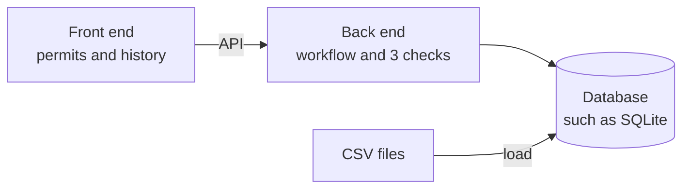

# Kuwait GitHub Copilot Hackathon - Nov 2026

    

🎯 **Your mission:** make sure only the right person can approve hazardous work, and prove it afterwards.

> [!IMPORTANT]
> Sample data only. Never bring real personnel data or credentials into this repo. This is a prototype, not a certified safety system, so never use it to authorize real work.

## 💼 The business problem

**The problem:** permits for hazardous work on an oil and gas site are still on paper, so permits get lost, steps get skipped and nobody can prove who approved what.

**Why it matters:** the wrong person approving hot work, or someone approving their own work, can be fatal. Every approval must come from the right person and be provable later.

## 🧰 What you'll build

You get the site's people, roles, sites and permit types. Your app lets a requester ask for a permit and the site's area authority approve and close it. It refuses any action by the wrong person and keeps a full history for every permit.



Build it in three parts: a database, a back end that runs the workflow and the checks behind an API, and a front end that does everything through that API.

**The data**

| File | Rows | What it represents |
|---|---:|---|
| [`users.csv`](data/users.csv) | 24 | The people who use the app: their roles (`roles`), the sites they're assigned to (`sites`) and whether they're active (`active`) |
| [`roles.csv`](data/roles.csv) | 4 | The roles: requester, area authority, HSE officer and viewer |
| [`sites.csv`](data/sites.csv) | 6 | The sites where the work happens (`site_id`) |
| [`permit_types.csv`](data/permit_types.csv) | 6 | The kinds of hazardous work that need a permit, such as hot work (`permit_type_id`) |
| [`sample_requests.csv`](data/sample_requests.csv) | 20 | Permit requests for one work week (15 to 19 November 2026) to try in your app: who asks (`requested_by`), where (`site_id`), for what (`permit_type_id`) and when (`valid_from`, `valid_to`) |

All data is synthetic. The sites, people and work are fictional. The [data dictionary](data/README.md) explains every column and the data-quality issues.

**The workflow**

| From | Action | To | Who can do it |
|---|---|---|---|
| (new) | Request | `REQUESTED` | A `REQUESTER` assigned to the site |
| `REQUESTED` | Review | `REVIEWED` | An active `HSE_OFFICER` assigned to the site |
| `REQUESTED` | Reject with a reason | `REJECTED` | An active `HSE_OFFICER` assigned to the site |
| `REVIEWED` | Approve | `APPROVED` | The site's `AREA_AUTHORITY` |
| `APPROVED` | Close, once the work is done and the site is safe | `CLOSED` | The site's `AREA_AUTHORITY` |

HSE rejection is terminal. Any other action is refused. Viewers can see permits but can't change them.

**The checks**

| The app asks | Check ID | How to check it in the data | Rule |
|---|---|---|---|
| Does this person have the right role? | `ROLE_REQUIRED` | Look up the user's `roles` and `active` flag in `users.csv`. | The user is active and holds the role the workflow table shows for the action |
| Is this person assigned to this site? | `SITE_ASSIGNMENT` | Compare the permit's `site_id` with the user's `sites`. | The site is in the user's list, or the list is `ALL` |
| Is someone approving their own work? | `SEPARATION_OF_DUTIES` | Compare the user with the permit's requester. | Nobody approves or closes a permit they requested |

Every refused action returns a clear reason that names the check, for example `SEPARATION_OF_DUTIES: U-007 requested this permit, so U-007 can't approve it`.

Every action appends an entry to the permit's history: the permit, the action, the from and to state, the user, the role used, the time and a comment. Entries can't be edited or deleted.

Decide these in your plan and cover them with tests:

- **Refused attempts:** whether they're logged in the history. We suggest yes: a refused approval is evidence too.
- **More than one role:** which role a user acts in when they hold several.
- **No area authority:** what happens at a site with no active area authority.
- **Invalid requests:** what happens to a request with an unknown permit type or an end time before its start time.
- **Messy data:** the data has deliberate quality issues. See [Things to know](data/README.md#things-to-know).

**What users see:** a permit register filtered by site and status, a full permit-details view for reviewing the work description, schedule, hazards and controls before approval, and the full history of each permit.

### Deliverables

Every challenge has the same five deliverables, sized for a team of 5–8 in 1.5–2 hours.

- [x] **Database:** load the users, roles, sites and permit types into SQLite, handle the issues in [Things to know](data/README.md#things-to-know), and store permits and their append-only history.
- [x] **Back end:** apply the workflow and three checks to each permit action; refusals include their check ID and explanation.
- [x] **API:** request, review/reject, approve, close, list permits, and read permit history; refusals return the documented check and reason.
- [x] **Front end:** request, HSE review/reject, approve, and close permits; show eligible reviewers and approvers, full workflow steps and permit details; filter the register, view history, and present management charts through the API.
- [x] **Tests:** cover each check, transitions, read/action endpoints, multi-role users, and `ALL` site access.

The [Copilot starter kit](#-your-copilot-starter-kit) has a skill for the database, `/data-import`, and one for the API, `/api-endpoint`.

Use any language, framework and database, as long as it runs locally from your README. SQLite is a good default: it's a single file and needs no server. No machine learning is needed: plain business rules only.

## ✅ Your solution

- **Team name:** AI Force 8
- **Team members:** Abhishek, Ahmad Ali, Mina, Sadiq, Tamer, Henawy, Imran, Khalid.
- **Stack:** Python 3.12, FastAPI, SQLite, pytest; the UI is server-rendered HTML with browser JavaScript.
- **Dashboard:** requester-linked site choices, a top-bar role filter for switching among eligible demo users, management totals for review/approval outcomes, weekly/monthly permit counts by site, requester distribution, and searchable/sortable permit and history views. The permit details view shows eligible HSE reviewers and Area Authority approvers, names each workflow step, and lets the HSE reviewer mark a request Reviewed or Reject it with a required reason before authority approval. Displayed permit and history times use `DD/MM/YYYY HH:MM`.

### Run it

From the repository root in PowerShell:

```powershell
python -m venv .venv
.\.venv\Scripts\Activate.ps1
python -m pip install -r requirements.txt
python -m uvicorn app.main:app --reload
```

Open http://127.0.0.1:8000 for the dashboard or http://127.0.0.1:8000/docs for the API docs. On startup, the app initializes `permit_work.db` and loads the roles, sites, permit types and users from `data/`; it also seeds three example permits.

### Test it

From the repository root:

```powershell
python -m pytest -q
```

### Check-to-test traceability

| Check / behavior | Implemented in | Test evidence |
|---|---|---|
| `ROLE_REQUIRED` | `app/workflow.py` | `test_request_requires_requester_role_and_site_assignment`, `test_approval_checks_site_assignment_and_normalizes_role_formatting`, `test_inactive_users_cannot_request_or_close_permits`, and `test_site_without_active_area_authority_is_rejected` |
| `SITE_ASSIGNMENT` | `app/workflow.py` | Request and approval denials are covered by `test_request_requires_requester_role_and_site_assignment` and `test_approval_checks_site_assignment_and_normalizes_role_formatting`. |
| `SEPARATION_OF_DUTIES` | `app/workflow.py` | `test_self_approval_is_refused_and_recorded_in_history` |
| Site `ALL` access and normalized roles | `app/workflow.py` | `test_requester_with_all_site_access_can_request_any_site` and `test_approval_checks_site_assignment_and_normalizes_role_formatting` |
| Valid and invalid workflow transitions | `app/workflow.py` | `test_request_review_approve_and_close_permit`, `test_hse_review_and_rejection_require_role_site_and_reason`, and `test_invalid_transition_is_refused_and_recorded_in_history` |
| Append-only history | `app/db.py`, `app/workflow.py` | `test_permit_history_cannot_be_updated_or_deleted`; refused actions are checked by `test_self_approval_is_refused_and_recorded_in_history`. |
| Audit identity and Kuwait timestamps | `app/workflow.py`, `app/db.py` | Lifecycle and read-endpoint tests verify the acting role, approver, and UTC+03:00 timestamps. |
| Read and action API endpoints | `app/main.py` | `test_read_endpoints_return_users_permits_and_history`, `test_get_permit_detail_contains_review_fields`, `test_review_endpoint_rejects_invalid_decisions_and_missing_permits`, and workflow lifecycle tests. |
| Invalid permit type and time range | `app/workflow.py` | `test_unknown_permit_type_and_invalid_date_are_rejected` |

### Copilot retrospective

- **Where Copilot saved us the most time:** building the workflow engine and API contract quickly without re-deriving the rules repeatedly.
- **Where we had to correct it:** tightening the permission ordering and ensuring refused actions were logged in history before returning the API error.

### Evidence checklist

- [x] Plan: `plan/plan.md`
- [x] Budget, usage-reading status, mid-point re-plan and optimization notes: [`docs/ai-credit-budget.md`](docs/ai-credit-budget.md)
- [x] Team conventions: `.github/copilot-instructions.md`
- [ ] Skills you wrote: `.github/skills/`
