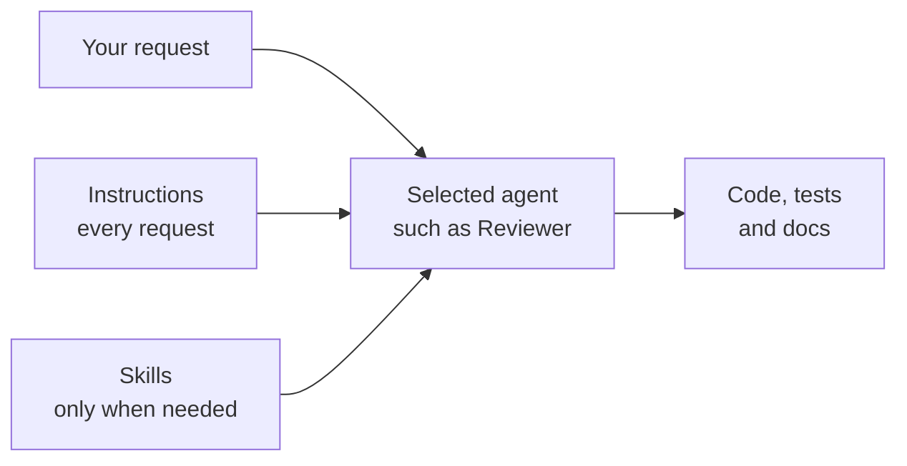

# Copilot customization guide

The `.github` folder in this repo has a starter kit that customizes GitHub Copilot for your project. This guide explains what each file does, when to use it and how to add your own.

## What's in the kit

```text
.github/
├── copilot-instructions.md          Instructions: added to every request
├── agents/
│   └── reviewer.agent.md            Custom agent: reviews code but can't edit it
└── skills/
    ├── data-import/                 Skill: loads CSV files into a database
    │   ├── SKILL.md                 The steps Copilot follows
    │   ├── scripts/                 Empty until the skill writes your profiler
    │   ├── references/
    │   │   ├── data-issues.md       Guidance Copilot reads when it needs it
    │   │   └── profiler-spec.md     What the profiler must report
    │   └── assets/
    │       └── import-plan.md       A template the skill fills in
    └── api-endpoint/                Skill: adds API endpoints the same way every time
        ├── SKILL.md                 The steps Copilot follows
        └── references/
            └── api-conventions.md   Default conventions to start from
```

Each file starts with a comment or a short introduction that explains it, so open them as you read. `data-import` is unfinished on purpose: you finish it by adding a profiler script, as described below. `api-endpoint` shows a simpler skill with one supporting file.

## When to use which

| | Instructions | Custom agent | Skill |
|---|---|---|---|
| **What it is** | Facts and conventions for your project | A role with its own instructions and tools | The steps for one task, plus any files it needs |
| **When Copilot uses it** | On every request | While it's selected in the **Agent** dropdown | When you type `/` and its name, or when your request matches its description |
| **Use it for** | Your stack, folder structure, naming and test command | Work that needs different behavior, such as reviewing without editing | A task you repeat, such as writing tests for each feature |
| **Example here** | [`copilot-instructions.md`](../.github/copilot-instructions.md) | [`reviewer.agent.md`](../.github/agents/reviewer.agent.md) | [`data-import`](../.github/skills/data-import/SKILL.md) and [`api-endpoint`](../.github/skills/api-endpoint/SKILL.md) |

A quick test: if Copilot should always know it, it's an instruction. If you'd switch roles for it, it's an agent. If you keep retyping it, it's a skill.

## How they work together



Copilot always adds your instructions. The agent you select decides what Copilot can do: the default **Agent** can edit files and run commands, while **Reviewer** can only read and search. A skill joins only when you call it or your request matches it.

Put each rule in one place: conventions in the instructions, task steps in a skill and role behavior in an agent. A rule in two places wastes credits, and the copies drift apart.

## Use them during the day

| When | What to do |
|---|---|
| Before you build | Replace the TODOs in `copilot-instructions.md` with your stack and conventions. Ask Copilot a question, then check that the file is listed in the references under its answer. |
| When you build the database | Type `/data-import`, or ask Copilot to load the data files. The first time, it writes a profiler in your language from the spec in the skill: review it and commit it to finish the skill. Then it profiles the files, shows you a plan, and builds and tests the import. |
| When you build the API | Type `/api-endpoint` for each endpoint, or ask Copilot to add one. It writes the contract in `docs/api.md` first, so the front end can start from it. |
| While you build each feature | Turn your test prompt into a skill, as in [Make your own skill](#make-your-own-skill), and run it for each feature. Then select **Reviewer** and ask it to review that feature. Switch back to **Agent** to fix what it finds. |

## Make your own skill

Start from a prompt you've typed more than once, such as one that writes tests. Your README's [Copilot focus](../README.md#-copilot-focus-for-this-challenge) section has examples.

1. In `.github/skills/`, create a folder named after the task, such as `rule-tests`. Use lowercase letters, numbers and hyphens.
2. Add a `SKILL.md` file to the folder with this frontmatter. The `name` must match the folder name.

   ```markdown
   ---
   name: rule-tests
   description: Writes unit tests for a business rule, including values exactly at the limits and the data issues in data/README.md. Use when you add or change a rule.
   ---
   ```

3. Below the frontmatter, paste your prompt and add any steps Copilot should follow.
4. Start a new chat and type `/rule-tests`, followed by the rule you want tests for. Refine the steps until you're happy with the tests.

Copilot decides when to load a skill from its description, so say what the skill does and when to use it. To run a skill only when you call it, add `disable-model-invocation: true`. A skill can also bundle files and link to them from `SKILL.md`, as `data-import` and `api-endpoint` do. Copilot opens them only when a step needs them.

## Make your own agent

Copy `reviewer.agent.md` to a new file in `.github/agents/`, such as `docs-writer.agent.md`, and change:

- `name`: what the **Agent** dropdown shows.
- `description`: what the agent does.
- `tools`: what it can do, such as `read`, `search`, `edit`, `execute` (run commands) and `web`. An instruction alone doesn't stop an agent from editing, so leave out the tools the role doesn't need.
- The body: the role's steps and what it returns. Keep shared conventions in `copilot-instructions.md` rather than in each agent.

VS Code suggests valid values as you type in the frontmatter.

## Spend smart

- Keep `copilot-instructions.md` short. Copilot sends it with every request, so each line costs credits all day.
- Put long steps, templates and examples in skills. Copilot reads only a skill's name and description until it needs the rest.
- Summarize big files instead of attaching them. A profiler like the one `data-import` asks for turns megabytes of CSV into a few kilobytes of facts.
- Give an agent a cheaper model. Add a `model:` line to `reviewer.agent.md` and pick a low-cost model from the suggestions.
- Measure the difference. Run the same task with and without a skill, or with a cheaper model, and compare the credits. That's a ready-made example for [section 4 of the budget sheet](ai-credit-budget.md#4-before-and-after-optimization).

## Check that Copilot found your files

- **VS Code:** run **Chat: Open Customizations** from the Command Palette to see the instructions, agents and skills Copilot found.
- **JetBrains IDEs:** in the Copilot Chat panel, select the settings icon, then **Customizations**.

If a file is missing, check its folder, its file name and its frontmatter, then start a new chat.

## Good to know

- **Supported IDEs:** instructions, custom agents and skills work in VS Code and Visual Studio, and in preview in JetBrains IDEs. Eclipse and Xcode don't support skills yet, so use Copilot CLI in the repo folder to run them. VS Code supports everything in this guide.
- **Prompt files:** older guides save reusable prompts as prompt files in `.github/prompts/`. VS Code is replacing them with skills, so use skills.
- **No README in `.github`:** GitHub would show `.github/README.md` instead of this repo's README, and Copilot treats every Markdown file in `.github/agents/` as an agent.
- **Reuse after today:** copy a skill folder or an agent file into another repo's `.github` folder. Skills in `~/.copilot/skills/` work in all your projects.
- **Going further:** path-specific instructions in `.github/instructions/` apply only to matching files. Hooks run commands at set points, such as after every edit. MCP servers connect Copilot to other tools. You don't need any of them today.

## Learn more

- [Copilot customization cheat sheet](https://docs.github.com/en/copilot/reference/customization-cheat-sheet)
- [Agent skills in VS Code](https://code.visualstudio.com/docs/agent-customization/agent-skills)
- [Custom agents in VS Code](https://code.visualstudio.com/docs/agent-customization/custom-agents)
- [Awesome Copilot](https://github.com/github/awesome-copilot): community agents and skills you can adapt
